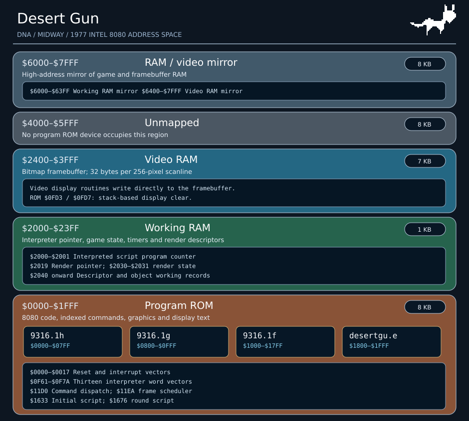

# Desert Gun


Desert Gun was developed by Dave Nutting Associates (DNA) and released by Midway in 1977. The game runs on Midway Intel 8080 arcade hardware. This project maintains its native 8080 disassembly, indexed-command game program, original ROM devices, graphics, and interpreter research.

Desert Gun uses a DNA indexed-command engine. Its interpreter fetches program bytes through a RAM-resident script pointer and dispatches to native Intel 8080 handlers.

| | |
| --- | --- |
| [Interpreted execution](#interpreted-program-architecture) | 13 table entries, 12 dispatched native words and an explicit frame handoff. |
| [Graphics and text](#graphics-and-text) | Individually labeled 8x10 font glyphs, target artwork, drawing records and message data. |
| [Sound](#sound) | Timed audio event streams, note/frequency register pairs and sound-port interrupt service. |
| [RAM and I/O](#ram-and-io) | Script pointer, object descriptors, game state, display RAM and interrupt-driven hardware services. |

## Project layout

`src/desertgun.asm`  
The maintained native 8080 disassembly, including interpreter, native handlers, command sequences and graphics. The build assembles this source directly.

`tools/zmac`, `tools/zmac.exe`  
Bundled zmac v1.3 assemblers. Neither build script generates source or runs Python.

`build/`  
Temporary assembled image `desertgu.bin`, listing `desertgu.lst` and split 2 KB ROM devices.

`roms/original/desertgu.zip`  
Preserved original four-device ROM archive and byte-verification reference.

`roms/desertgu.zip`  
Verified MAME-compatible ROM archive produced by the build.

`build.sh`, `build.bat`  
Native assembly, device splitting, SHA-1 comparison and ZIP packaging.

`tools/`  
Bundled zmac assemblers and separate, optional ROM RE tooling; Python is never invoked by the build.

`docs/`  
Standalone technical reference, separate RE/engineering task tracker, original manual.

`images/`  
Game imagery, the canonical Intel 8080 memory map and a transparent native SVG fox mascot.

## Build

Linux:

```sh
./build.sh
```

Windows:

```bat
build.bat
```

Both scripts assemble `src/desertgun.asm` directly with zmac v1.3, split the assembled 8 KB image into four 2 KB devices, verify each against its original SHA-1, and create `roms/desertgu.zip`. Intermediate files remain in `build/`; the original archive is unchanged.

MAME:

```sh
mame desertgu -rompath roms -window -skip_gameinfo
```

## ROM organization

Four 2 KB devices occupy the main program ROM space.

| ROM | CPU address |
| --- | --- |
| `9316.1h` | `$0000–$07FF` |
| `9316.1g` | `$0800–$0FFF` |
| `9316.1f` | `$1000–$17FF` |
| `desertgu.e` | `$1800–$1FFF` |



The reset and interrupt vectors occupy the opening ROM bytes. Program ROM runs from `$0000` through `$1FFF`, followed by the RAM and video regions used by the 8080 game logic.

## Interpreted program architecture

The native interpreter at `$11D0` fetches a command through the 16-bit script program counter at RAM `$2000`. The little-endian vector table at `$0F61` has 13 slots (`$00–$0C`). The zero command branches directly to the frame scheduler at `$11EA`; the remaining 12 commands dispatch to native 8080 handlers.

| Component | Address | Function |
| --- | --- | --- |
| `BYTECODE_FETCH_DISPATCH` | `$11D0` | Fetch and dispatch interpreted commands |
| Native command vector table | `$0F61–$0F7A` | 13 little-endian native handler addresses |
| Frame scheduler | `$11EA` | Native per-frame services |
| Boot continuation | `$11C3` | Initialize interpreter script state |
| Script return trampoline | `$11C9` | Establish native return into interpreter |
| Initial interpreted script | `$1633` | Starting program |
| Round reset script | `$1676` | Alternate game script root |

The command handlers cover drawing modes, mode/pointer state, branching, byte storage, video clear, descriptor initialization, flags, scene reset and drawing packet transfer. Their operand widths and effects are cataloged in technical reference. The table now names each of the 13 slots, and the round program at `$1679` is decoded into **39 command records with typed inline bytes and words**.

The dispatch tail matches the ten-byte indexed-address/indirect-jump mechanism studied in DNA's Gun Fight, Boot Hill, Sea Wolf, Tornado Baseball, Double Play and Extra Inning. This is evidence for shared execution techniques rather than identity of every command number or word behavior.

See the [technical reference](docs/DESERT-GUN-TECHNICAL-REFERENCE.md) for the annotated interpreter, command vocabulary and frame behavior.

## Graphics and text

The ROM has 8x10 digit and alphabet bitmaps starting at `$0288`. The assembly separates the display font into individual glyph records, with original bytes and inline `#` / `.` raster illustrations. Other ROM regions hold packed gun, target, scene and object artwork, positioning tables and encoded text.

The native drawing routines near `$0132` and `$0167` interpret encoded graphics and copy pixel data into video memory. The graphics pool at `$06DC–$0F60` is divided into **47 directly referenced graphic resources**. Its opening eight-pixel pattern is annotated row by row. The animation frame table at `$14BB` has sixteen frame-state indices and eight little-endian graphic pointers at `$14CB`.

The object-motion controller selects between an eight-entry pointer table at `$1564` and a six-entry alternative at `$1574`. These select **16 labeled motion sequences** within `$1580–$1632`, with selector/graphic-address records and `$FF` sequence terminators.

The text area contains the `DESERT GUN` title beginning at `$1A5E`, scoring and bonus prompts, and high-bit-delimited messages in **English, German, French and Danish**. The language directory at `$1A2F` references four verified delimiter anchors.

## Sound

The audio service reads the active stream pointer at RAM `$2012`, processes duration and note/event bytes, looks up two-byte sound-generator register values at ROM `$04FB`, and outputs the selected pair to ports `$05` and `$06`. Note durations, reloads and counters use `$200E–$2011` and `$201F`.

Five source-addressed sound streams begin at `$10B2`, `$10D8`, `$10F2`, `$110C` and `$1128`. The maintained ASM names the audio service and each stream, replacing the former generic object-sequence interpretation.

## RAM and I/O

| Address | Use |
| --- | --- |
| `$2000–$2001` | Current interpreted script pointer |
| `$200E–$2011` | Sound duration, counters and event parameters |
| `$2012–$2013` | Sound event stream pointer |
| `$2019` | Rendering pointer |
| `$2030–$2031` | Rendering mode and control state |
| `$2032` | Game timer |
| `$2040` onward | Descriptor and object working records |
| `$2400–$3FFF` | Bitmapped display RAM |

Native services handle periodic interrupts, input ports, object/game timers, drawing and display operations. The game uses the Intel 8080 stack for selected graphics and control transfers.

## Technical documentation

The complete interpreter and software investigation is consolidated in [Desert Gun — Technical Reference](docs/DESERT-GUN-TECHNICAL-REFERENCE.md).

All outstanding reverse-engineering work, progress, engineering debt and acceptance criteria are maintained separately in [RE Tasks](docs/RE-TASKS.md).

## References

- [Technical reference](docs/DESERT-GUN-TECHNICAL-REFERENCE.md)
- [Desert Gun reference manual](docs/DesertGun.pdf)
- [MAME Midway Intel 8080 driver](https://github.com/mamedev/mame/blob/master/src/mame/midway/8080bw.cpp)
