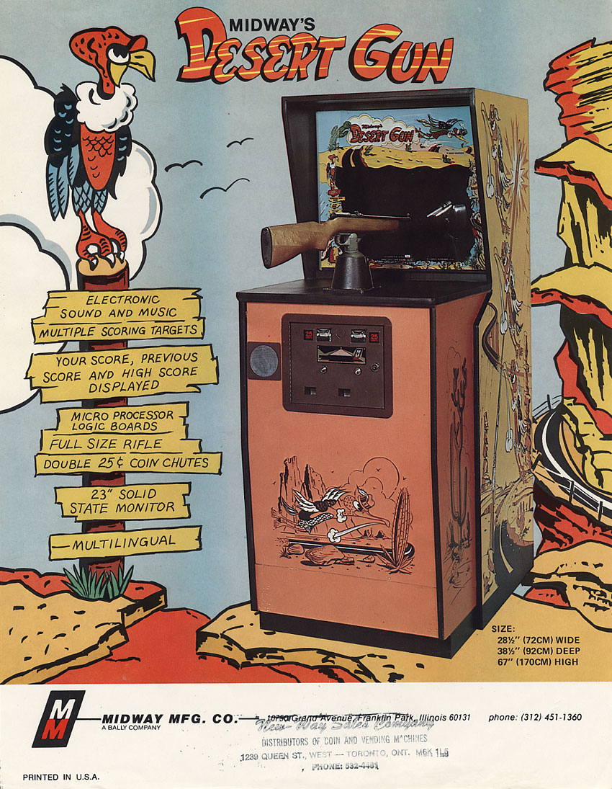

# Desert Gun

Desert Gun (1977) is an Intel 8080 Midway/Dave Nutting Associates arcade game. This repository preserves the original ROM set, reconstructs native executable instructions, and documents an indexed-bytecode interpreter present in its program ROM.

## Interpreter and DNA 8080 history

The native dispatcher at `$11D0` fetches indexed 8080 game commands through script pointer `$2000` and vector table `$0F61`; the initial script begins at `$1633`. Second-pass word decoding establishes **13 entries ($00–$0C), with $00 taking an explicit scheduler branch and 12 nonzero native words**. Opcode $00 hands off directly to the frame scheduler at $11EA, in contrast with Gun Fight's zero-command repeat/wait logic.

See [per-word native effects and operand formats](docs/8080-WORD-SEMANTICS.md), [original recovered vectors](docs/interpreter.md), and [machine-readable trace](docs/recovery.json). Working names in the semantic catalog describe recovered machine behavior; they are not claimed as the original DNA source-language spellings.

## Project layout

| Path | Purpose |
|---|---|
| `roms/original/desertgu.zip` | Original ROM devices; source of truth |
| `src/desertgun.asm` | Annotated native reconstruction generated from original ROM |
| `src/zout/desertgun.lst` | zmac assembler listing |
| `tools/recover_8080.py` | Reset/IRQ, branch, and command-vector traced native 8080 recovery |
| `tools/interpreter_lineage.py` | Native bytecode vector inventory |
| `tools/verify_rom.py` | Byte-for-byte rebuilt ROM verification, SHA hashes and MAME ROM ZIP |
| `docs/memory-map.svg` | Dark-theme device/region map with evidence caveats |
| `build.sh`, `build.bat` | Linux and Windows reproducible build scripts using bundled zmac 1.3 |

## Build

Linux: `./build.sh`; Windows: `build.bat`. Both regenerate source from the preserved original chips, assemble with the repository's bundled zmac 1.3, split the resulting binary into original chip devices, and fail if **any ROM byte differs**. Built ROM devices and the MAME ZIP are written to `roms/build/`.

## Research status

Confirmed: native indexed dispatch, original device ordering/hashes and target handlers. Native reconstruction follows reset/interrupt vectors, branch targets and dispatch-table entries; unrecovered/ambiguous bytes remain `DB` rather than being misrepresented as reachable code. The map marks candidate board RAM/video addresses separately from verified ROM ranges. Detailed command operand types and all alternate native entry paths remain subjects for deeper RE.
