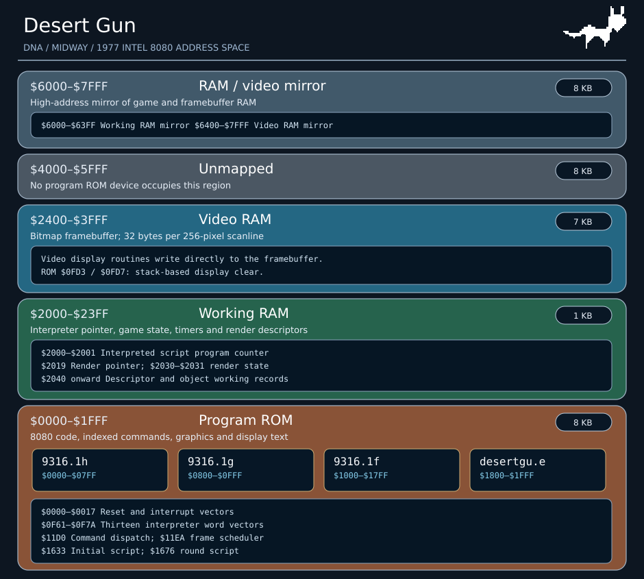

# Desert Gun — Technical Reference

**Game:** Desert Gun (1977) · **Developer:** Dave Nutting Associates · **Publisher:** Midway · **CPU:** Intel 8080 · **Program ROM:** four 2 KB devices ($0000–$1FFF).

**Scope:** This is the standalone technical account of the Desert Gun ROM reconstruction, indexed-command interpreter, machine-code routines, graphics, animation, sound, display text, hardware, and DNA interpreter lineage. It incorporates the verified research from the earlier documents in one ordered narrative. Descriptive labels are reconstructed engineering names, not asserted original DNA source identifiers.

**Authoritative software:** `src/desertgun.asm`; **original evidence:** `roms/original/desertgu.zip`. The checked-in source is directly assembled with bundled zmac v1.3. The original archive is read-only. The detailed runtime and machine-level findings below are preserved independently of temporary analysis outputs.

## 1. ROM and CPU organization

| Region | Address | Description |
| --- | --- | --- |
| 9316.1h | $0000–$07FF | Reset/interrupt vectors, hardware tests, drawing services and glyphs |
| 9316.1g | $0800–$0FFF | Packed graphics, indexed interpreter vector table, beginning of native word handlers |
| 9316.1f | $1000–$17FF | Word handlers, object/frame logic, sound events, game scripts |
| desertgu.e | $1800–$1FFF | Game logic, screen messages, gameplay records and final ROM checksum byte |
| Working RAM | $2000–$23FF | Bytecode instruction pointer, per-frame object state, render and sound state |
| Video RAM | $2400–$3FFF | 8080 framebuffer |



The video-clear routine writes via the 8080 stack pointer. The ROM-byte verification includes the final $4E at $1FFF: the last 2 KB device's additive sum is $68, and the ROM test applies seed $97 to reach $FF before INC A yields zero. Other device seed bytes appear in the startup checksum reference table.

**Memory-model terminology:** ROM is the physical storage medium, not an instruction language. When the 8080 program counter points to machine code, ROM bytes are instructions. The main interpreter and the object-motion reader also fetch ROM bytes as data. Only code they explicitly execute is native Intel 8080 machine code.

## 2. The native 8080 engine and interpreted commands

### Fetch, dispatch and return

The Desert Gun interpreter uses a byte-indexed 8080 handler table, a two-byte saved script PC, and a native frame scheduler. At `$11D0` it loads the pointer held in RAM `$2000`, reads a command, and branches on zero. Nonzero commands advance the script PC past the opcode, put the inline operand position in **DE**, then index a table of native handler addresses at **`$0F61 + 2×opcode`**. This exact dispatch tail appears at `$11E0`:

```asm
; Actual ROM $11D0-$11E9, symbolic operand labels shortened:
LD HL,($2000)       ; $11D0 - interpreted instruction pointer
LD A,(HL)           ; $11D3 - token
AND A               ; $11D4
JP Z,$11EA          ; $11D5 - $00 yields to native scheduler
INC HL              ; $11D8
LD ($2000),HL       ; $11D9 - operand cursor
EX DE,HL            ; $11DC
LD HL,$0F61         ; $11DD - vector base
RLCA                ; $11E0 - index * 2
LD C,A              ; $11E1
LD B,$00            ; $11E2
ADD HL,BC           ; $11E4
LD A,(HL)           ; $11E5
INC HL              ; $11E6
LD H,(HL)           ; $11E7
LD L,A              ; $11E8
JP (HL)             ; $11E9 - native handler
```

The physical table `$0F61–$0F7A` has thirteen 16-bit entries `$00–$0C`. **Zero is reserved for frame handoff**: although slot zero contains `$0FAB` (a native `RET`), `$11D5` branches to `$11EA` first. Thus there are **12 nonzero executable words**, not 13 dispatched handler bodies.

The boot continuation at **`$11C3–$11CF`** was previously misclassified as `DB`. It executes `LD HL,$1633; LD ($2000),HL; LD HL,$11C9; PUSH HL; EI; OUT ($04),A`, then falls into the fetch loop. The pushed `$11C9` forms the native return continuation: handler `RET` returns to a short sequence that pushes its return address again and re-enters dispatch. This is a concrete **native return trampoline**, not a threaded TERSE data stack.

### Indexed-word ABI

| Token | Native entry | Inline bytes | Observed native effect |
|---|---|---:|---|
| `00` | scheduler `11EA` | 0 | Frame handoff; no bytecode PC increment |
| `01` | `0F94` | 1 | Drawing mode $0132; reads C from inline byte and calls $1A06 |
| `02` | `0FA2` | 1 | Writes inline byte to RAM $2031 |
| `03` | `0FAC` | 3 | Writes immediate mode to RAM $2030; 16-bit operand to RAM $2019 |
| `04` | `0FBE` | 2 | Replaces script PC at RAM $2000 with inline little-endian address |
| `05` | `0FC7` | 3 | Stores inline byte at inline 16-bit destination address |
| `06` | `0FD3` | 0 | Clears video memory using stack writes and resumes native continuation |
| `07` | `100E` | 0 | Initializes fixed descriptor bytes in RAM around $2040–$204A |
| `08` | `1047` | 4 | Reads two inline 16-bit fields; sets drawing/descriptor state and routes to renderer |
| `09` | `0F8E` | 1 | Drawing mode $0167; shares common operand-fetch path with $01 |
| `0A` | `106D` | 2 | Clears bit $08 at inline RAM address (mask $F7) |
| `0B` | `107A` | 0 | Conditional round/reset service; installs resume script $1676 and sets outputs |
| `0C` | `0F7B` | 5 | One-byte drawing parameter followed by two 16-bit addresses; dispatches renderer $0132 |

The names are behavior descriptions, not claimed original DNA source spellings. The complete observed per-word behavior is recorded in the ABI table below. Every word has a concrete vector; script scans establish **20 packets within the two original bounded roots** at two entry roots. This is not a claim to have discovered every runtime-generated execution path.

### Initial ROM script

The initial script begins at **`$1633`**:

```text
$1633  06                 CLEAR_DISPLAY_MEMORY
$1634  08 06 20 A0 3E     INITIALIZE_DRAW_AND_BRANCH  ($2006, $3EA0)
$1639  01 05              DRAW_WITH_MODE_0132         $05
$163B  08 0B 20 00 24     INITIALIZE_DRAW_AND_BRANCH  ($200B, $2400)
$1640  01 06              DRAW_WITH_MODE_0132         $06
$1642  01 04              DRAW_WITH_MODE_0132         $04
$1644  08 1C 20 1B 24     INITIALIZE_DRAW_AND_BRANCH  ($201C, $241B)
$1649  07                 INITIALIZE_RAM_DESCRIPTOR
$164A  05 01 81 20        STORE_IMMEDIATE_AT_ADDRESS   $01 -> $2081
$164E  05 01 B1 20        STORE_IMMEDIATE_AT_ADDRESS   $01 -> $20B1
...
$1669  00                 FRAME_HANDOFF
```

The second currently rooted program starts at **`$1676`**: `02 1E` stores $1E in $2031, followed by `00` at $1678 for frame handoff. These packets are **bytecode**, not native instructions. The source annotates opcode and operand boundaries explicitly.

### Frame scheduling

At **`$11EA`**, the zero path calls `$12E5, $12B1, $129E, $1936, $1232, $1503, $124E`. It checks RAM $200D and conditionally calls `$1318, $1142, $16F0`. The scheduler returns to the native continuation; a zero script token can therefore remain at its site across frames until code changes the script pointer.

**Shared drawing ABI:** word $01 sets HL=$0132; word $09 sets HL=$0167; both jump to native helper `$0F97`, which pushes the renderer continuation, obtains the inline parameter from DE, advances RAM $2000, then calls `$1A06`. Word $0C parses five inline bytes and jumps to `$0132`. These are actual shared handler bodies, unlike coincidentally numbered words in other games.

**Fast screen clear:** word $06 at `$0FD3` pops its return continuation into HL; the shared clear routine at `$0FD7` disables interrupts, writes zeros by pushing BC repeatedly over video memory using SP, restores SP=$2400, then does `JP (HL)` at $0FF3. The same clear primitive is called at boot from `$11BA` and from diagnostics `$01C7`: both set HL to a **different continuation address**, then jump directly to `$0FD7`.

## 3. Source reconstruction and native code recovery

### Recovered native-code regions

| Address | Native region | Reason it was missed |
|---|---|---|
| `$01D0–$0267` | Display diagnostic and hardware exercise; includes screen sweeps, port $02 reads, tests and display helper calls | Reached via `$01C7 → $0FD7 → JP (HL)`, not a direct CALL edge |
| `$11C3–$11CF` | Initialize script PC, native return trampoline and I/O; boot continuation | Reached via `$11BA → $0FD7 → JP (HL)` |
| `$1DE9` | One-byte `RET` return stub | Isolated fallthrough between native routines |
| `$17FF–$1801` | Single `JP $0132`, physically spanning 2 KB chip boundary | Old generator split instruction into raw DB bytes at device boundary |

The recovered code adds **82 instruction starts** to the prior native source, for **2,311 native instructions / 3,896 native instruction bytes** in the revised assembly. Real image data and compact game scripts remain as data. The preserved assembly's 8,192 reconstructed bytes compare exactly against the previous ROM-authoritative source, with no duplicate bytes, holes, or undefined symbolic labels. This is an **independent source-byte check**, not a substitute for a freshly assembled zmac roundtrip.

## 4. Interpreter ABI — detailed evidence and confidence

| Op | Entry | Working descriptive name (not original) | Input and observed effect | Confidence |
|---|---|---|---|---|
| 00 | scheduler 11EA | FRAME_HANDOFF | No pointer advancement; invokes native frame/update services at `$12E5/$12B1/$129E/$1936/$1232/$1503/$124E`, conditional extras | H |
| 01 | 0F94 | DRAW_WITH_MODE_0132 | Consumes 1 byte to C, then invokes renderer/helper `$1A06`, continuation via `$0132` | M |
| 02 | 0FA2 | SET_2031 | Reads 1 immediate byte, writes `$2031` | H |
| 03 | 0FAC | SET_2030_AND_POINTER | Reads 1 byte into `$2030` followed by address16 into `$2019` | H |
| 04 | 0FBE | GOTO_SCRIPT | Reads address16, replaces bytecode pointer `$2000` | H |
| 05 | 0FC7 | STORE_IMMEDIATE_AT_ADDRESS | Reads immediate byte then address16; writes byte to designated RAM address | H |
| 06 | 0FD3 | CLEAR_DISPLAY_MEMORY | Pops return continuation, sets SP `$4030`, disables interrupts, writes 16 zero words per iteration until counter wraps, restores SP `$2400` and resumes via `PCHL` | H |
| 07 | 100E | INITIALIZE_RAM_DESCRIPTOR | Installs fixed 11-byte descriptor structure in RAM around `$204A` | M |
| 08 | 1047 | INITIALIZE_DRAW_AND_BRANCH | Reads address16, calls `$1033` twice, writes `$2083` and passes through `$11AC`; then reads second address16, changes `$2000` and dispatches drawing service `$0132` | M |
| 09 | 0F8E | DRAW_WITH_MODE_0167 | No additional local operands before common `$0F97`; mode/continuation differs from op `01` | M |
| 0A | 106D | CLEAR_BIT_08 | Reads address16, masks target byte with `$F7` | H |
| 0B | 107A | ROUND_OR_SCENE_RESET | Checks/decrements `$2018`, redirects script pointer to `$1676`, initializes outputs `$07/$03`, reads input port `$02`, resets related game-state pointers | M |
| 0C | 0F7B | DRAW_OR_COPY_PACKET | Reads 1 byte and two address16 values, updates script pointer, jumps to rendering service `$0132` | M |

**Widths:** after the opcode, `02:1`, `03:3`, `04:2`, `05:3`, `0A:2`, `0C:5`, `08:4`; other opcodes need control-flow-aware packet checks. Hardware port operations are direct evidence, but “scene”/“draw” labels describe observed call sites rather than recovered original source names.

## 5. Interpreter control flow and scheduler behavior

**Shared drawing ABI:** word $01 sets HL=$0132; word $09 sets HL=$0167; both jump to native helper `$0F97`, which pushes the renderer continuation, obtains the inline parameter from DE, advances RAM $2000, then calls `$1A06`. Word $0C parses five inline bytes and jumps to `$0132`. These are actual shared handler bodies, unlike coincidentally numbered words in other games.

**Fast screen clear:** word $06 at `$0FD3` pops its return continuation into HL; the shared clear routine at `$0FD7` disables interrupts, writes zeros by pushing BC repeatedly over video memory using SP, restores SP=$2400, then does `JP (HL)` at $0FF3. The same clear primitive is called at boot from `$11BA` and from diagnostics `$01C7`: both set HL to a **different continuation address**, then jump directly to `$0FD7`.

## 6. Interpreted startup and round scripts


Distinct statically decoded packet sites: 20

| ROM | Word | Operand bytes | Length |
|---|---|---|---:|
| 1633 | 06 |  | 1 |
| 1634 | 08 | 0620A03E | 5 |
| 1639 | 01 | 05 | 2 |
| 163B | 08 | 0B200024 | 5 |
| 1640 | 01 | 06 | 2 |
| 1642 | 01 | 04 | 2 |
| 1644 | 08 | 1C201B24 | 5 |
| 1649 | 07 |  | 1 |
| 164A | 05 | 018120 | 4 |
| 164E | 05 | 01B120 | 4 |
| 1652 | 03 | 103316 | 4 |
| 1656 | 05 | 013520 | 4 |
| 165A | 05 | 013820 | 4 |
| 165E | 0C | 0B5E1A8A2F | 6 |
| 1664 | 0B |  | 1 |
| 1665 | 01 | 02 | 2 |
| 1667 | 02 | 3C | 2 |
| 1669 | 00 |  | 1 |
| 1676 | 02 | 1E | 2 |
| 1678 | 00 |  | 1 |

### Original bounded-root traversal

| Root | Packets | Stop |
|---|---:|---|
| 1633 | 18 | zero-frame-handoff at 1669 |
| 1676 | 2 | zero-frame-handoff at 1678 |

### Original bounded-root word counts

| Word | Sites |
|---|---:|
| 00 | 2 |
| 01 | 4 |
| 02 | 2 |
| 03 | 1 |
| 05 | 4 |
| 06 | 1 |
| 07 | 1 |
| 08 | 3 |
| 0B | 1 |
| 0C | 1 |

Desert Gun opcode $05 writes an immediate byte to an inline 16-bit address; opcode $06 clears screen memory using no inline operands.

This is static rooted decoding; it is not a complete emulation of interrupt-driven execution.


### Native handler entry listings (first instructions only)

These are bounded instruction-entry excerpts, not complete control-flow traces. The names are descriptive and the zero-index table entry is bypassed by the interpreter.

#### $00 — Bypassed return stub ($0FAB)

2 known ROM command packet site(s). Handler:

```asm
RET
```

#### $01 — DRAW_MODE_A ($0F94)

4 known ROM command packet site(s). Handler:

```asm
LD HL,$0132
```

#### $02 — SET_RAM_2031 ($0FA2)

2 known ROM command packet site(s). Handler:

```asm
EX DE,HL
LD A,(HL)
LD ($2031),A
INC HL
LD ($2000),HL
```

#### $03 — SET_MODE_AND_PTR ($0FAC)

1 known ROM command packet site(s). Handler:

```asm
EX DE,HL
LD A,(HL)
LD ($2030),A
INC HL
LD E,(HL)
INC HL
LD D,(HL)
INC HL
LD ($2000),HL
EX DE,HL
LD ($2019),HL
RET
```

#### $04 — BRANCH_SCRIPT ($0FBE)

0 known ROM command packet site(s). Handler:

```asm
EX DE,HL
LD E,(HL)
INC HL
LD D,(HL)
EX DE,HL
LD ($2000),HL
RET
```

#### $05 — STORE_BYTE ($0FC7)

4 known ROM command packet site(s). Handler:

```asm
EX DE,HL
LD A,(HL)
INC HL
LD E,(HL)
INC HL
LD D,(HL)
INC HL
LD ($2000),HL
LD (DE),A
RET
```

#### $06 — CLEAR_DISPLAY ($0FD3)

1 known ROM command packet site(s). Handler:

```asm
POP HL
LD SP,$4030
```

#### $07 — INIT_DESCRIPTOR ($100E)

1 known ROM command packet site(s). Handler:

```asm
LD HL,$204A
LD BC,$0BFE
LD (HL),B
DEC HL
LD (HL),C
DEC HL
LD (HL),$00
DEC HL
LD (HL),$30
DEC HL
LD (HL),$01
DEC HL
```

#### $08 — DRAW_AND_BRANCH ($1047)

3 known ROM command packet site(s). Handler:

```asm
EX DE,HL
LD E,(HL)
INC HL
LD D,(HL)
INC HL
LD BC,$2083
PUSH BC
PUSH HL
PUSH BC
CALL $1033
CALL $1033
LD A,$30
```

#### $09 — DRAW_MODE_B ($0F8E)

0 known ROM command packet site(s). Handler:

```asm
LD HL,$0167
JP $0F97
```

#### $0A — CLEAR_FLAG_BIT3 ($106D)

0 known ROM command packet site(s). Handler:

```asm
EX DE,HL
LD E,(HL)
INC HL
LD D,(HL)
INC HL
LD ($2000),HL
LD A,(DE)
AND $F7
LD (DE),A
RET
```

#### $0B — RESET_ROUND ($107A)

1 known ROM command packet site(s). Handler:

```asm
LD HL,$2018
LD A,(HL)
AND A
RET Z
```

#### $0C — DRAW_PACKET ($0F7B)

1 known ROM command packet site(s). Handler:

```asm
EX DE,HL
LD A,(HL)
INC HL
LD E,(HL)
INC HL
LD D,(HL)
INC HL
PUSH DE
LD E,(HL)
INC HL
LD D,(HL)
INC HL
```


## 7. ROM pointer tables and data ownership

### Static interpreter facts
- The dispatch loop at `$11D0–$11E9` reads from pointer RAM `$2000`.
- Opcode `$00` branches directly to scheduler `$11EA` before incrementing the pointer; the table's slot-zero `$0FAB` is not used for that instruction.
- Twelve nonzero handlers occupy vector slots `$01–$0C` in the 26-byte table `$0F61–$0F7A`. Widths for `$01/$02/$03/$04/$05/$08/$09/$0A/$0C` are obtained from native pointer movement. `$06/$07/$0B` have no immediate bytes in the bounded linear pass.
- Opcode `$04` stores a 16-bit destination directly into `$2000`. Opcode `$0B` may redirect program state to `$1676` depending on round conditions.

## 8. Data structures and graphics

**Font.** $0288–$0403 contains 380 bytes, organized into 38 individually labeled 8×10 glyphs with source-level pixel comments.

**Packed graphics.** $06DC–$0F60 comprises 2,181 original bytes. Direct source references identify 47 graphic resource entry points. The resource records remain original byte sequences; source declarations retain their exact order, and the initial eight-pixel raster has inline `#`/`.` art. ROM boundaries do not delimit game-level records.

**Frame table.** The record at $14BB contains sixteen frame indices followed by eight graphic-resource pointers beginning at $14CB; associated control parameters and object-key/offset pairs follow. The native reader selects entries, not independent executable routines.

**Object motion.** Primary eight-entry pointer table at $1564 and alternate six-entry table at $1574 select records within $1580–$1632. The 16 labeled motion streams start with little-endian resource addresses, include byte-selector/16-bit graphic-address pairs, and use $FF stream terminators. These target addresses identify *data records*, not 8080 instruction entry points. The object reader obtains the pointer with table indexing and compares object fields before updating game state.

**Interpreted script:** the main root at $1633 and round root at $1676 are inline bytecode, not 8080 instructions. Besides the first two bounded roots, the source contains a linear parsing of 39 command records at $1679–$16EF. Distinguish accurate byte boundaries from runtime reachability when tracing the scheduler, whose $00 handler does not advance the script PC.

## 9. Audio and timed events

The interrupt service uses RAM $2012 as a pointer into timed sound-event streams, processes duration/count fields in $200E–$2011 and $201F, indexes paired sound-generator register bytes at ROM $04FB, and writes to I/O ports $05 and $06. Five source-addressed sound sequences begin at $10B2, $10D8, $10F2, $110C, and $1128. These bytes were formerly misclassified as generic object sequences. Their code consumer establishes audio ownership.

## 10. Display messages and language selection

The text directory at $1A2F selects high-bit-delimited strings. The $1A5E title begins **DESERT GUN**, with two initial bytes immediately before $1A60. Readable game text and menu phrases are stored in English, German, French, and Danish. The directory selects message delimiters at $1AC3, $1B1B, $1B79, and $1BD9. The high bit marks a string boundary rather than an 8080 opcode.

## 11. Native/data coverage and verification method

A byte-position audit against the original 8 KB ROM identifies 2,311 native instruction starts (3,896 native instruction bytes). Previously missed native continuations include $01D0–$0267, $11C3–$11CF, $1DE9 and the jump spanning the $17FF/$1800 device boundary. The structural audit of the source revision preceding this consolidation accounted for all 8,192 ROM addresses, matched 4,296 typed-data bytes and verified 251 symbolic machine-code targets against original addresses. *These are structural audits, not substitutes for assembling the latest source and comparing all four original device hashes.*

The build path is direct: `build.sh` and `build.bat` assemble `src/desertgun.asm` with zmac v1.3, split 8,192 bytes into four original device images in ignored `build/`, compare the device SHA-1s, and publish `roms/desertgu.zip` for MAME. No Python script is involved in the build. Native executable bytes and interpreted data retain different roles even when both reside in ROM.

**Original ROM device SHA-1s**

| Device | SHA-1 |
| --- | --- |
| 9316.1h | 4d0a3a59d4f8181c6e30966a6b1d19ba5b29c398 |
| 9316.1g | 8fb8e85844a8ec6c0722883013ecdd4eeaeb08c1 |
| 9316.1f | 1cc4e9b0aa7e9546c133bd40d40ede6f2fbe93ba |
| desertgu.e | 202433dfb174901bd3b91e843d9d697a8333ef9e |

## 12. DNA interpreter lineage

### Cross-game comparison

| Game | Era | Dispatcher and script PC | Observed continuity |
|---|---|---|---|
| Gun Fight | 1975 | $03A7, RAM $2000; 21 credible indexed entries | Early byte-indexed native handlers; $00 is repeat/wait rather than direct zero frame handoff; fast stack-based screen clear also appears |
| Sea Wolf | 1976 | $045E, RAM $2000, vector base $09E8 | Same ten-byte native indexing/jump tail; native renderer and time/game services |
| Tornado Baseball | 1976 | 26-word interpreter, RAM $2000 | Same ten-byte indexing/jump tail, larger vocabulary and timed frame scheduling |
| Boot Hill | 1977 | $0F85, RAM $2006, 16 nonzero handlers | Same tail and zero scheduler; different script pointer address and game-word ABI |
| **Desert Gun** | **1977** | **$11D0, RAM $2000, 12 nonzero handlers** | Identical dispatcher tail, $00 native frame scheduler, several compact display/state/branch words |
| Double Play | 1977 | 28 positions, RAM $2000 | Same dispatch tail with expanded baseball game program |
| Extra Inning | 1978 | $073E, RAM $2000, table $120C, 28 positions | Explicit boundary $1C and frame scheduler; additional extensions and ROM-resident script banks |
| Sea Wolf II | 1978 | Z80 TERSE | Later *direct-threaded* words; different runtime, stack convention and native ABI |

**Interpretation:** the byte-for-byte match of the *tail* and shared RAM script-PC pattern support strong continuity of DNA's 8080 indexed execution mechanism. The **individual word numbers do not define a stable cross-game ABI**. A particularly concrete reuse *inside Desert Gun* is the same video-clear primitive serving word $06, startup, and diagnostics. A likely design progression is a native reusable service collection plus small 8080 script vocabularies, then larger sports/game vocabularies, and subsequently the Z80 TERSE direct-threaded production framework. Keep the verified mechanics distinct from chronological attribution.

### Gun Fight comparison

Both games retain a native 8080 handler vocabulary, pointer `$2000`, address-bearing inline command operands and graphics-state words. In Gun Fight the zero handler repeats/conditions a command using `$20C5`; in Desert Gun a **separate zero path performs the frame scheduler**. This is a meaningful architectural refinement, not evidence that their vocabularies are numeric-position compatible.

### Chronological evidence

| Game | Date | Architecture established | Meaningful contrast |
|---|---|---|---|
| Gun Fight | 1975 | byte-indexed native dispatch; pointer `$2000`; vector base `$09AE` | command words combine memory mutation, display preparation, interrupt/I/O management and game-state handling |
| Tornado Baseball | 1976 | 26-command indexed interpreter; pointer `$2000`; frame handoff `$1A` | larger game-action vocabulary and explicit scheduled frame transition |
| Boot Hill | 1977 | 16 nonzero command vectors; pointer `$2006`; zero scheduler handoff | related architecture, but changed pointer convention; direct source ancestry not established |
| Desert Gun | 1977 | 12 nonzero command vectors; pointer `$2000`; zero scheduler handoff | small, specialized game-word set; follows later dispatcher/scheduler organization |
| Double Play | 1977 | 28 command positions; pointer `$2000` | extensible 28-position baseball command family |
| Extra Inning | 1978 | 28 command positions; pointer `$2000` | strong continuity with Double Play in ordered command packets |

**What is established:** the 1975 Gun Fight ROM implements a one-byte index into native addresses at `$09AE`, and the 1977 Desert Gun ROM similarly indexes `$0F61`. This pushes bytecode-style native dispatch earlier than Tornado Baseball. A shared word name or direct reuse of source must be supported by matching native behavior and operand ABI; corresponding opcode numbers alone are not evidence.

### Method and definitions

Distinguish **slot** (index addressable by dispatch), **handler** (native code with a reachable entry), **word** (defined machine-state effect and operand format), and **invoked word** (actually found in decoded game scripts). The observed command catalog uses confidence labels: **H** = direct machine-state semantics and operand width identifiable; **M** = operation established but high-level game meaning incomplete; **L** = partial semantics only. “Handler exists” must not be counted as a fully understood source-language word. In particular, no speculative friendly label is treated as an original DNA name.

